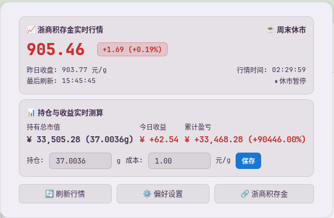

# 浙商积存金实时行情与持仓监控插件 (GNOME Shell 46)

原生 GNOME Shell 扩展插件，基于京东金融浙商积存金实时行情接口开发。



## 功能特性
1. **顶栏常驻展示**：
   - 默认常驻系统顶栏，实时展示金价；
   - 遵循国内金融习惯：**红涨绿跌**（可在偏好设置中切换为绿涨红跌）；
   - 支持自定义顶栏格式：`现价 + 涨跌幅`、`现价 + 涨跌额`、`现价 + 箭头`、`仅现价`；
   - 非交易时段/省电时自动呈现状态标识（如 `[休市]` 或 `[省电]`）。
2. **节假日联动与开市时间控制**：
   - 默认对接上海黄金交易所（SGE）及京东黄金积存金交易时间段：
     - 早盘：09:00 - 11:30
     - 午盘：13:30 - 15:30
     - 夜盘：20:00 - 次日 02:30（周五夜盘延续至周六凌晨 02:30）
   - **支持自定义开市时段**：可在偏好设置中自由设定早盘、午盘、夜盘时段（支持留空禁用某时段，或一键恢复标准默认值）；
   - **法定节假日智能联动**：自动拉取并本地缓存国家法定放假日历，节假日全天休市期间暂停后台无谓请求；
   - 周末（周六 02:30 后至周一 09:00 前）休市暂停请求；手动点击「刷新」按钮不受限。
3. **电池省电模式**：
   - 原生通过 UPower DBus 监听电源状态；
   - 笔记本使用电池供电时自动暂停后台轮询，节约电量与网络资源；
   - 恢复市电连接时自动唤醒并即时同步最新行情。
4. **持仓收益实时测算**：
   - 点击顶栏展开详细卡片，可直接配置「持仓克数」（支持4位小数精度）与「买入成本均价」；
   - 实时自动测算并高亮展示：**持有总市值**、**今日收益**、**累计盈亏与收益率**。
5. **行情波动强提醒**：
   - 支持自定义「今日累计涨跌幅阈值（%）」与「短时突发跳变阈值（元/g）」；
   - 价格异动达到阈值时触发 GNOME 原生常驻紧急通知（Urgency.CRITICAL）与系统警报声音；
   - 内置智能跳空防抖（过滤开机冷启动与休市跳空）及独立防骚扰冷却计时器。
6. **原生偏好设置**：
   - 基于 Libadwaita 原生设置窗口，支持配置刷新频率（1~600秒）、格式、配色、持仓基准、开市时段自定义、行情异动强提醒、节假日联动与省电模式开关。

## 目录结构
```
~/.local/share/gnome-shell/extensions/gold-price-tracker@poweran/
├── metadata.json       # GNOME 扩展元数据声明与 UUID
├── extension.js        # GNOME 46 核心逻辑（ESM + Soup 3.0 异步网络 + PanelMenu）
├── holidayManager.js   # 节假日联动与开市交易时段智能判定
├── prefs.js            # Libadwaita 原生设置页面
├── stylesheet.css      # 顶栏及弹出菜单样式（深浅主题自适应）
├── schemas/            # GSettings schema 配置与编译缓存
├── icons/              # 矢量图标
└── README.md
```

## 安装与启用方式

### 1. 从源码安装
克隆仓库至本地扩展目录并编译 GSettings 配置：
```bash
git clone https://github.com/powerAn2020/gnome-shell-extension-gold-price-tracker.git ~/.local/share/gnome-shell/extensions/gold-price-tracker@poweran
glib-compile-schemas ~/.local/share/gnome-shell/extensions/gold-price-tracker@poweran/schemas/
```

### 2. 启用扩展
在 GNOME Wayland 环境下，新安装的扩展需要在新会话中被 Shell 扫描识别：
1. **注销当前桌面并重新登录**（或重启电脑）；
2. 在「扩展」（GNOME Extensions / 扩展管理器）应用中开启「**实时金价监控**」，或在终端执行：
   ```bash
   gnome-extensions enable gold-price-tracker@poweran
   ```

